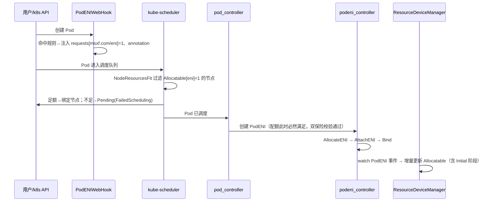

# PodENI 配额分配与调度优化 — MutatingWebhook 技术设计方案

| 项目 | 内容 |
|---|---|
| 系统 | lira（MCK VPC CNI） |
| 模块 | PodENI 准入控制 / 节点 ENI 资源记账 |
| 关联组件 | lira-manager（pod_controller / podeni_controller / ResourceDeviceManager）、lira-resource、kube-scheduler |
| 状态 | 草稿版 |

---

## 1. 背景

lira 当前为每个非 hostNetwork Pod 独占分配一块云 ENI（PodENI CR：`Initial → Created → Bind`）。
每个节点可绑定的 ENI 数量受实例规格限制，通过节点 label `eni_counts`（master 走配置
`MasterENINum`）声明，由 `lira-resource` 写入节点 `Status.Capacity["msxf.com/eni"]`，
由 `ResourceDeviceManager` 维护 `Status.Allocatable["msxf.com/eni"] = Capacity - 已分配`。

## 2. 现状问题分析

### 2.1 配额校验发生在调度之后（核心问题）

```
kube-scheduler 调度 Pod（不感知 ENI 配额）
    → pod_controller watch 到 Pod 已调度，创建 PodENI CR（Phase=Initial）
    → podeni_controller Initial 阶段执行 checkNodeENIConfig 校验配额
    → 超额：报 ErrorInsufficientENINUM，Pod 已绑死节点，卡在 ContainerCreating 反复重试
```

- Pod 对象**不请求** `msxf.com/eni` 扩展资源 → 调度器 NodeResourcesFit 完全不参与
  ENI 配额判断，会把 Pod 调度到 ENI 已满的节点。
- 配额校验点在 [podeni_controller.go:188](../pkg/controllers/podeni_controller.go#L188)
  `checkNodeENIConfig`，调用点在 Initial 阶段 reconcile——属"事后校验"。
- 失败表现：Pod 长期 `ContainerCreating`，事件 `CniCreateENIError`，用户无法从调度
  事件（FailedScheduling）得到真实原因。

### 2.2 Allocatable 记账竞态窗口

[resource.go:111](../pkg/controllers/resource.go#L111) `getAllocatedENINum` 的统计口径是
`podEni.Spec.ENI.ID != ""`，而 PodENI 在 `Initial` 阶段 ENI 尚未在云端创建、ID 为空：

```
Pod A 调度到 node-1 → PodENI-A 创建（Initial，ID=""）→ Allocatable 未扣减
    → Pod B 被调度到 node-1（记账视角仍有余量）
    → PodENI-A 完成创建（ID≠""）→ checkNodeENIConfig(B) 超额失败
```

### 2.3 性能与冲突

- `checkNodeENIConfig` 每次全量 `List` 所有 PodENI 计数，且所有节点共用一把
  `nodeMutex`（[podeni_controller.go:189](../pkg/controllers/podeni_controller.go#L189)）。
- `ResourceDeviceManager.Start`（[resource.go:41](../pkg/controllers/resource.go#L41)）
  每 **1s** 全量 List PodENI + List Node，并对每个有差值的节点 patch status。
  节点/PodENI 规模增长后 apiserver 压力与 resourceVersion 冲突线性放大。
- `IncreaseNodeENIConfig`/`ReduceNodeENIConfig` 注解计数路径已被注释废弃
  （[podeni_controller.go:592-602](../pkg/controllers/podeni_controller.go#L592-L602)），
  证明"控制器里自己记账 + 注解计数"的路线此前已走过弯路。

## 3. 方案总览

**核心思路：把配额校验从"调度后控制器数数"前移为"调度器原生扩展资源调度"。**

Kubernetes 原生机制：Pod 若 `requests["msxf.com/eni"]=1`，调度器 NodeResourcesFit
插件自动过滤 `Allocatable[msxf.com/eni] < 1` 的节点。该机制与 NVIDIA device plugin
上报 `nvidia.com/gpu`、Terway 的 `alibabacloud.com/pod-eni`、AWS VPC CNI 的
`vpc.amazonaws.com/pod-eni` 为同一套模式，已在业界大规模验证。

改造分两个模块：

| 模块 | 组件 | 职责 |
|---|---|---|
| 一、PodENIWebHook | lira-manager 内新增 MutatingWebhook | Pod CREATE 时注入 `msxf.com/eni=1` 请求 + 识别标记 |
| 二、记账改造 | 重构 ResourceDeviceManager | 统计口径修正（消灭竞态）、1s 全量轮询改为事件驱动 + 周期对账 |
| （保留）兜底路径 | podeni_controller.checkNodeENIConfig | 作为第二道防线保留，列表改为 informer 缓存 |

改造后链路：



## 4. 模块一：PodENIWebHook 详细设计

### 4.1 注册配置（MutatingWebhookConfiguration）

```yaml
apiVersion: admissionregistration.k8s.io/v1
kind: MutatingWebhookConfiguration
metadata:
  name: lira-podeni-webhook
webhooks:
- name: podeni.mck.msxf.com
  admissionReviewVersions: ["v1"]
  sideEffects: None
  reinvocationPolicy: Never
  timeoutSeconds: 3
  failurePolicy: Ignore          # 见 4.5 决策
  matchPolicy: Exact
  namespaceSelector:             # 灰度开关：按 namespace label 放开
    matchExpressions:
    - key: mck.msxf.com/vpc-eni
      operator: In
      values: ["enabled"]
  objectSelector: {}             # 可选：按 pod label 二级放开
  rules:
  - operations: ["CREATE"]       # 只拦创建，更新不拦（request 不可变）
    apiGroups: [""]
    apiVersions: ["v1"]
    resources: ["pods"]
    scope: Namespaced
  clientConfig:
    service:
      name: lira-manager-webhook
      namespace: kube-system
      path: /mutate-v1-pod
    caBundle: {CA_BUNDLE}
```

要点：

- `operations: [CREATE]`——扩展资源 request 只在创建时注入，Pod spec 后续不可变，
  无需拦 UPDATE，把拦截面降到最小。
- `namespaceSelector` 按 label `mck.msxf.com/vpc-eni=enabled` 灰度：测试 namespace
  先开，全量后改为对所有业务 namespace 生效。kube-system / lira 自身 namespace
  不打该 label，天然排除。
- 注册的回调地址走 Service（hostNetwork 场景下 webhook Pod 若随 lira-manager 以
  DaemonSet 部署，可改 `url: https://{节点IP}:9443/mutate-v1-pod`，与现有部署形态对齐，
  部署时二选一）。

### 4.2 Mutate 逻辑

```
POST /mutate-v1-pod  (AdmissionReview v1)

输入: Pod 对象
逻辑:
1. pod.Spec.HostNetwork == true            → 不处理（allowed 原样返回）
2. 已存在 requests["msxf.com/eni"]         → 不处理（幂等，防止重复注入）
3. annotation["mck.msxf.com/eni"] == "off" → 不处理（Pod 级逃生口）
4. 任意 container / initContainer:
     resources.requests["msxf.com/eni"] = "1"
5. pod.Annotations["mck.msxf.com/eni-request"] = "true"   # 识别标记+审计
返回: JSON Patch
```

注入 JSON Patch 示例（容器无任何 requests 时需先创建 resources/requests 路径，
Patch 数组按路径从外到内构造）：

```json
[
  {"op":"add","path":"/spec/containers/0/resources/requests","value":{"msxf.com/eni":"1"}},
  {"op":"add","path":"/metadata/annotations","value":{"mck.msxf.com/eni-request":"true"}}
]
```

设计细节：

- **只注入 requests，不注入 limits**：扩展资源不参与 QoS 与驱逐，limits 无意义；
  若用户显式配置了 `limits[msxf.com/eni]` 而无 requests，API 默认 requests=limits，
  无需处理。
- **containers 与 initContainers 全部注入**：init request 取逐容器最大值的语义下，
  全部注入 1 即等效。
- **幂等**：步骤 2 保证 webhook 重装/reinvocation 不会叠加注入。
- **逻辑保持轻量**：纯内存 match + patch，不做任何 IO（不查 PodENI、不查 Node），
  单次处理 <1ms，参考超分方案中"hook 服务逻辑简单"的原则。

### 4.3 与 pod_controller 的配合

- `processPod`（[pod_controller.go:376](../pkg/controllers/pod_controller.go#L376)）当前对
  所有非 hostNetwork Pod 建 PodENI。**兼容期不改判定逻辑**（webhook 失效的 Pod 仍走
  旧路径兜底）；灰度全量后，可收紧为"仅带 `mck.msxf.com/eni-request=true` 标记的
  Pod 建 PodENI"，将 Webhook 作为唯一入口。
- PodENI 的 `checkNodeENIConfig` 保留作为第二道防线（防 web-hook 与记账短暂不一致
  时的超卖），但 List 改为走 manager 的 informer 缓存（client 默认即缓存读），
  并将全局 `nodeMutex` 按 nodeName 分锁（`sync.Map[nodeName]*sync.Mutex`）。

### 4.4 部署与证书

- webhook Server 复用 lira-manager 进程（controller-runtime `webhook.Server`，
  默认 :9443），跟随现有 leader election：**webhook 服务必须所有副本同时在线**
  （apiserver 直连 Service 不走 leader），故 webhook 监听不参与 leader 选择，
  所有副本挂同一 Service。
- 证书：优先复用集群 cert-manager（`Certificate` + CA injection，kustomize 中
  `[WEBHOOK]/[CERTMANAGER]` 脚手架已预留）；无 cert-manager 的环境采用自签
  CA + Secret 挂载，注册时回填 `caBundle`（与超分方案 secret.yaml 流程一致）。
- 生命周期：作为 lira 基础组件随集群初始化安装，走基础组件变更流程。

### 4.5 failurePolicy 决策

| 选项 | 行为 | 影响 |
|---|---|---|
| **Ignore（采用）** | webhook 不可用时放行未注入的 Pod | Pod 走旧路径：pod_controller 照常建 PodENI + checkNodeENIConfig 事后校验，**功能退化为现状，不会更糟** |
| Fail | webhook 不可用时拒绝所有 Pod 创建 | 强一致，但 webhook 故障 = 集群不可建 Pod，可用性风险过高 |

配套要求：`webhook_rejected_total`/`webhook_request_total`（注入率）暴露为
Prometheus 指标，注入率异常下跌即告警，避免 Ignore 模式下静默降级无感知。

## 5. 模块二：Allocatable 记账改造

### 5.1 统计口径修正（消灭 2.2 竞态）

`getAllocatedENINum` 统计条件由

```go
podEni.Spec.ENI.ID != "" && podEni.Status.NodeName == node.Name
```

改为

```go
podEni.Status.NodeName == node.Name &&
    podEni.DeletionTimestamp.IsZero() &&
    podEni.Status.Phase != v1beta1.ENIPhaseDeleting
```

即：**只要 PodENI 存在且未进入删除流程就计入占用**（Initial/Created/Bind 全算）。
PodENI CR 的创建先于云端 ENI 创建，Pod 被调度即占坑，语义与调度器视角对齐。

### 5.2 轮询改事件驱动

| 现状 | 改造后 |
|---|---|
| 1s 全量 List PodENI + Node | informer（controller-runtime cache）watch PodENI 增删改，内存维护 `map[nodeName]int` 计数 |
| 每轮对全部节点 patch | 仅计数值变化的节点才 patch Allocatable |
| 无自愈 | 60s 周期全量对账一次（List 缓存，非直连 apiserver），纠偏 drift 并覆盖 controller 重启场景 |

Patch 冲突处理保留现有 5 次重试；对账发现与内存计数不一致时以对账结果为准并告警
（计数泄漏：如节点已删除但 PodENI 残留）。

### 5.3 lira-resource（Capacity 初始化）不变

Capacity=实例规格上限（`eni_counts` label / `MasterENINum`），只在不存在时初始化一次，
逻辑不变。Capacity 与 Allocatable 的更新来源分离：lira-resource 管"总量"，
ResourceDeviceManager 管"余量"，避免两个组件互相覆盖。

## 6. 调度链路前后对比

| 场景 | 现状 | 改造后 |
|---|---|---|
| 节点 ENI 已满，新 Pod 调度 | 正常调度成功 → ContainerCreating 卡死 + CniCreateENIError | **Pending，FailedScheduling：Insufficient msxf.com/eni**，原因直观 |
| 并发超额调度 | Initial 阶段竞态可超卖 | 调度器 assumed-pod 记账，天然无竞态 |
| 配额校验时机 | 调度后（控制器） | **调度时（调度器原生）** + 控制器双保险 |
| apiserver 压力 | 每秒全量 List×2、高频 patch | 事件驱动 patch，仅对账时读缓存 |
| webhook 故障 | — | 降级为现状行为（Ignore + 旧路径），有监控 |

## 7. 兼容性、灰度与回滚

1. **灰度**：`namespaceSelector` 按 label 放开 namespace；先测试环境（t2）运行
   1~2 周，覆盖并发创建、节点打满、webhook 停机演练后，再全量业务 namespace。
2. **Pod 级逃生口**：`annotation["mck.msxf.com/eni"]="off"` 的 Pod 不注入
   （特殊 Pod 走共享 ENI/默认网络的场景预留）。
3. **存量 Pod**：request 仅创建时注入，存量运行中 Pod 不受影响；升级期间新旧
   Pod 并存，记账口径对两类 Pod 均成立（旧 Pod 无 request 但有 PodENI，照常计数）。
4. **回滚**：删除 MutatingWebhookConfiguration 即回到现状；已注入 request 的
   Pod 删除重建后自然恢复旧形态。记账口径修正与事件驱动改造独立开关
   （FeatureFlag / 配置），可单独回退。

## 8. 风险与对策

| 风险 | 分析 | 对策 |
|---|---|---|
| kubelet 对扩展资源的二次校验 | kubelet admission 会按本机 Allocatable 校验 Pod request，记账错误会导致 kubelet 拒 Pod | 事件驱动 + 周期对账保证准确；对账偏差即告警 |
| Allocatable 短时偏大造成超卖 | PodENI 创建失败重试期间占用不释放 | PodENI 失败即进入 Deleting（现有逻辑），计入占用；checkNodeENIConfig 双保险 |
| webhook 成为 Pod 创建链路依赖 | Ignore 模式下故障静默 | 注入率指标 + 告警；演练 webhook 停机场景 |
| 每节点 ENI 上限含主网卡占用 | `eni_counts` label 由人工配置，配错即全局配额失真 | 上线前巡检脚本校验 label 值 vs 实例规格；差异告警 |
| PodENI 计数泄漏（节点删除、CR 残留） | 内存计数与真实漂移 | 60s 对账兜底 + 偏差告警 |

## 9. 测试场景

1. **注入正确性**：普通 Pod 注入 1；hostNetwork 不注入；kube-system 不注入；
   已带 request 的 Pod 不重复注入；`eni=off` 逃生口生效；initContainer 注入。
2. **调度**：节点 ENI 打满（eni_counts=N，建 N 个 Pod）后新 Pod Pending 且事件为
   `FailedScheduling: Insufficient msxf.com/eni`；释放 1 个 Pod 后新 Pod 立即调度成功。
3. **竞态回归**：剩余配额 2 时并发创建 5 个 Pod → 恰好 2 个调度成功、3 个 Pending，
   无 ContainerCreating 卡死。
4. **故障演练**：停 webhook → Pod 创建成功（走兜底路径）+ 注入率告警；恢复后自动回切。
5. **记账**：PodENI Initial 阶段 Allocatable 已扣减；PodENI 删除后 Allocatable 回升；
   手工制造计数漂移，60s 内对账纠正。
6. **性能**：批量创建 100 Pod，对比改造前后 apiserver 请求量（List/Patch QPS 应
   显著下降）、Pod 端到端调度时延无回退。

## 10. 工作量粗估

| 项 | 内容 | 粗估 |
|---|---|---|
| 模块一 | webhook handler + 注册 + 证书 + 部署编排 | 3~4 人日 |
| 模块二 | 记账口径修正 + 事件驱动重构 + 对账 | 3~4 人日 |
| 测试 | 功能 + 竞态 + 故障演练 + 性能 | 4~5 人日 |
| 合计 | | **约 2 周**（含 t2 灰度观察） |
