# 基于 MCK 的智算平台设计方案（总纲）

| 项 | 内容 |
|---|---|
| 方案代号 | MCK-AIC（智算平台总纲） |
| 版本 / 状态 | V1.0 · 设计评审稿（未实施） |
| 日期 | 2026-10-18 |
| 输入文档 | 《MCK支持AI上云建设方向讨论》（下称"讨论文档"，引用格式 `文档§x.x`） |
| 关联文档 | [mck-gpu-platform-design.md](mck-gpu-platform-design.md)（算力详设：隔离分级 / XID 分级 / 摘卡时序 / 容量边界）；[mck-ai-platform-design.md](mck-ai-platform-design.md)（落地版：组件版本 / 部署拓扑 / 配置样例）；[智算平台-伪代码与配置.md](智算平台-伪代码与配置.md)（实现基线：核实结论 / CRD / 伪代码 / YAML 配置）；[智算平台-业务流程与话术.md](智算平台-业务流程与话术.md)（面试向：需求重审 / 三条流程主线 / 话术） |
| 本文档定位 | 按需求方五个维度组织的设计总纲：**异构芯片管理 → 驱动管理 → 异构芯片调度 → 租户任务管理 → 双底座（ECS 推理 / BMS 训练）** |

**标注约定（全文强制）**：

- `文档§x.x` = 讨论文档可查证的内容；
- **【设计】** = 文档没写，本方案的设计推导；
- **【外部】** = 文档外技术选型，选型依据与出处见算力详设对应章节。

**图表**：附录 A 提供 12 幅 Mermaid 图——架构图 A1–A3、流程图 B1–B4、时序图 C1–C5，与正文章节的映射见附录 A 首表（VSCode 预览需 Mermaid 插件；GitHub/Typora 原生渲染）。

---

## 1. 设计输入

### 1.1 讨论文档已确定的事实（平台的直接输入）

| # | 文档事实 | 出处 |
|---|---|---|
| F1 | MCK 支持 GPU 卡 + AI 套件，支持两种计算底座 ECS 和 BMS：**ECS 用于推理场景的开发测试和生产**（主要卡为英伟达 A 系列、4090/4090D、H20 等）；**BMS 用于生产数据训练和开发测试训练**（主要卡为 H200/H800/4090D 等） | 文档§4 |
| F2 | MCK 规划新产品功能一：**异构 GPU 多驱动管理**——同一个集群内支持多种 Nvidia 卡和多种版本驱动部署，不同版本驱动相关的资源支持可配置；ECS 已支持直通的 GPU 卡可以快速上线并交付 | 文档§3.1 |
| F3 | MCK 规划新产品功能二：**纳管云外节点**——云外节点满足 MCK 计算节点基线要求后可加入 MCK 集群，MCK 节点功能（节点池、标签、污点等）均适用；研究院存量/增量 GPU 卡先纳管入池，按产品建设节奏逐步切换成 MCK 自有节点 | 文档§3.1 |
| F4 | 卡型现状：共 15 种 GPU 卡，主要涉及华为（310/910A）和英伟达（A 系列/H 系列/4090 等），分布在 5 个网络分区 | 文档§1.3 |
| F5 | 适配现状：2025Q1 MCK GPU 节点 MVP 已投产，已适配 4090/4090D（占比 13%）；ECS 直通已支持 H20/4090/4090D/A30/3090（占比 33.3%） | 文档§1.4 |
| F6 | 业务用途分类：生产模型推理服务（PowerAgent）/ 生产数据的模型开发训练（HPC 平台）/ 模型开发测试 / 业务测试联调 | 文档§1.3 |
| F7 | 裸金属产品需支持 MCK 原生容器集群部署方案；研究院智马平台需要 GPU 型 MCK；GPU 容器产品支持用户增长研发部、数字化与流程改善部智能助手等场景 | 文档§1.1 |

### 1.2 讨论文档定义的问题（平台要解决的）

| # | 问题 | 量化事实 | 出处 |
|---|---|---|---|
| P1 | 卡资源紧张 | 协作模式为整机搬迁：A800 整机 8 卡，马上云开发环境仅用 1 张；搬迁窗口仅 1 天、业务中断只能 4 小时 | 文档§2.1 |
| P2 | 搬迁耗时 | 服务器频繁在三个环境间搬迁（运维归属变更/上架/网络分配/装机/入资源池），A30 服务器从协调到加入 dev4 耗时 2 周；存在电口/光口更换问题 | 文档§2.2 |
| P3 | 业务迁移受限 | 单卡型适配周期 1~1.5 个月（搬迁 1 周 + 开发适配 2 周 + 测试上线 2 周），每季度重复；新卡 5090/5090D/B200 到位后将闲置 | 文档§2.3 |

### 1.3 文档没写、由本方案补齐的维度

| 维度 | 文档覆盖程度 | 本方案处理 |
|---|---|---|
| 异构芯片管理 | 文档只到"纳管云外节点 + 基线要求"，设备台账/健康闭环没写 | §3 |
| 驱动管理 | 文档§3.1 功能一给了方向（同集群多卡型多驱动、资源可配置），实现模型没写 | §4 |
| 异构芯片调度 | 文档没写调度设计（队列/gang/切分均未提及） | §5 |
| 租户任务管理 | **文档完全没写**（租户模型、任务生命周期、配额均无） | §6 |
| 双底座分工 | 文档§4 给了分工与卡型，交付/运维差异没展开 | §7 |

---

## 2. 总体架构

### 2.1 架构分层与文档依据映射

```
┌──────────────────────────────────────────────────────────────────────────┐
│ 产品/经营层  GPU 订单 · 纳管申请 · 租户与配额管理 · 任务看板 · 计量对账        │ 【设计】文档§1.2 团队分工
│             （解决方案=方案设计/GPU卡资源协调；SRE=GPU卡资源管理；            │  隐含"平台统一经营"诉求
│               智能计算研发团队=需求方+GPU资源提供方）                        │
├──────────────────────────────────────────────────────────────────────────┤
│ 调度层       队列与配额 · gang 批调度 · 切分资源调度 · 拓扑亲和 ·            │ 【设计+外部】文档没写调度设计
│             碎片治理 · 抢占/潮汐                                           │
├──────────────────────────────────────────────────────────────────────────┤
│ 设备管理层   适配矩阵（卡型×驱动×内核×OS×底座×切分模式）·                    │ 驱动管理=文档§3.1 功能一；
│             设备台账 · 健康检测与故障闭环 · 驱动交付/升级                    │ 台账/健康闭环【设计】
├──────────────────────────────────────────────────────────────────────────┤
│ MCK 底座     集群生命周期 · 节点池/标签/污点 · 插件体系 · 计量 ·             │ 文档§3.1：纳管节点
│             变更管道（ClusterOperation/playbook）                          │ "节点功能均适用"
├──────────────────────────────────────────────────────────────────────────┤
│ 双底座       ECS：推理开发测试 + 生产推理（A系列/4090/4090D/H20）           │ 文档§4
│             BMS：生产数据训练 + 开发测试训练（H200/H800/4090D）             │
│ 云外节点     纳管入池（过渡态，标签/污点/节点池全适用）→ 逐步切换自有节点      │ 文档§3.1 功能二
└──────────────────────────────────────────────────────────────────────────┘
```

### 2.2 关键架构决策

| # | 决策 | 依据 |
|---|---|---|
| D1 | 双底座分工固定：推理负载落 ECS，训练负载落 BMS，作业模板按底座预置 | 文档§4 |
| D2 | 一池一集群（网络分区 × 用途 × 卡型），不做跨分区统一调度 | 【设计】文档没写集群划分方式；推导依据：文档§1.3 五个网络分区物理隔离、纳管以集群为单位（文档§3.1） |
| D3 | 技术主线定案：**Volcano（调度）+ HAMi volcano-vgpu 路线（切分）** + 自研控制面四件套（适配矩阵/准入配额/设备台账/计量对账），以 AI 插件包叠加在 MCK 之上，不改 MCK 内核 | 【设计+外部】文档§4 只说"MCK 支持 GPU 卡 + AI 套件"；选型依据见 §2.3 与算力详设 §3.3 |
| D4 | 所有适配成果沉淀为配置数据（适配矩阵），新卡型 = 验证 + 登记，不改代码 | 【设计】直接对 P3（适配周期 1~1.5 个月、新卡闲置） |
| D5 | 研究院存量卡先纳管后切换，纳管期与自有期同一套调度/管理能力 | 文档§3.1 功能二的推进方式 |

### 2.3 技术主线：Volcano + HAMi（volcano-vgpu 路线）

**【外部+设计】** 选型定案（依据=算力详设§3.3 选型表；版本基线=落地版§1.1，仅这两个版本经源码与官方发布核对过）：

| 领域 | 定案 | 版本基线 | 备注 |
|---|---|---|---|
| 批量调度 | Volcano | v1.16.0 | 与现网 K8s 版本兼容性 POC 核对（落地版§7 未确认项 1） |
| 算力切分 | HAMi volcano-vgpu 路线 | v2.10.0（源码研究基于 2.6.1） | **不装 HAMi scheduler**（HAMi 官方文档：volcano-vgpu 路线调度完全交 Volcano） |

**能力 → 机制映射**（平台每个能力都落在两个开源项目的具体机制上）：

| 平台能力 | Volcano 机制 | HAMi 机制 |
|---|---|---|
| 整组原子调度（训练） | PodGroup / vcjob + gang 插件 | — |
| 队列与配额 | Queue（deserved/capability/weight）+ proportion 插件 | — |
| 抢占与回收 | preempt / reclaim 动作 + PriorityClass | — |
| 切分资源调度 | deviceshare 插件（`VGPUEnable: true`） | volcano-vgpu-device-plugin 注册 `volcano.sh/vgpu-*` 扩展资源 |
| 显存/算力隔离 | — | HAMi-core（LD_PRELOAD 拦截 CUDA API） |
| 碎片治理 | binpack 插件 | — |
| 拓扑调度（四期） | HyperNode + numa-aware | — |

**自研边界（HAMi/Volcano 不做的，正是自研控制面四件套）**：

| 自研组件 | 为什么两件套覆盖不了 |
|---|---|
| 适配矩阵 | 多卡型×多驱动×切分模式的验证成果治理，是 MCK 交付管道与准入的参数源 |
| 准入与租户配额 | Queue capability 对 vGPU 扩展资源的支持边界待核对（见下）；租户级配额运营/计费标签校验需在准入层做 |
| 设备台账与故障闭环 | 开源项目不做设备台账、XID 分级摘卡、工单闭环 |
| 计量对账 | vGPU 折算卡时、三方对账、经营口径是平台经营需求 |

> 调整原则一句话：**调度和切分不造轮子（Volcano+HAMi），治理和经营必须自研**——这也是"自研了多少"的面试答案。

**随定案收敛的边界（评审关注）**：

1. Queue capability/deserved 对 `volcano.sh/vgpu-*` 扩展资源的支持边界 `待核对`——若不支持，租户 vGPU 配额在准入 webhook 层校验（伪代码配置§3.1⑤），Queue 层按 `nvidia.com/gpu` 折算兜底；
2. HAMi 对昇腾 910A 的支持范围 `待核实`——fallback：910A 独占 + 厂商原生 device-plugin（§3.5 不变）；
3. MIG 的纳管方式（HAMi 对 MIG 的支持范围）`待核实`——fallback：MIG 资源独立注册；
4. Volcano v1.16 × HAMi v2.10 是已核对兼容组合（落地版），任一方升级需同步回归验证。

---

## 3. 异构芯片管理

### 3.1 卡型准入：适配矩阵（方案核心配置资产）

**【设计】** 针对 P3：把"卡型 × 驱动 × 内核 × OS × 底座 × 切分模式"的验证成果沉淀为配置数据，由适配流水线维护，交付管道与下单校验共同消费：

```yaml
# gpu-adapt-matrix（每资源池一份 ConfigMap）
cards:
  - model: "4090D"
    drivers: ["550.54.15"]            # 该卡验证通过的驱动版本，多版本 = 多节点池共存
    kernels: ["4.19", "5.4"]
    os: ["centos7.9", "kylinV10"]
    ecsPassthrough: true              # ECS 直通已验证（文档§1.4）→ 快速上线通道
    base: [ecs, bms]
    shareMode: ["vgpu"]
  - model: "H200"
    drivers: [">=550"]
    base: [bms]                       # 训练底座专属（文档§4）
    shareMode: ["mig", "exclusive"]
  - model: "910A"
    vendor: ascend                    # 华为卡（文档§1.3）
    mode: exclusive                   # 国产存量卡：独占 + 厂商原生 device-plugin
    devicePlugin: "ascend-device-plugin"
```

- 交付管道从矩阵取参；下单校验对不在矩阵内的机型直接拒绝并返回适配状态——新卡从"改代码发版"变为"矩阵加一行"；
- 矩阵同时是 §4 驱动管理的唯一参数源（驱动版本、内核锁定、OS 白名单）。

### 3.2 设备台账与状态机

**【设计】** 文档没写设备管理，SRE 的"GPU 卡资源管理"职责（文档§1.2）需要台账支撑：

- **台账字段**：卡 UUID / 卡型 / 槽位 / 序列号 / 驱动版本 / 所属节点 / 状态 / 关联工单号；由节点侧 device-plugin 上报初始化，与集群真实状态周期对账；
- **状态机**：

```
在途(采购/纳管) ─► 在线(健康) ─► 降级(ECC可纠/趋势异常) ─► 隔离(taint,待修) ─► 维修(工单)
                     ▲                                                      │
                     └──── 回归验证通过（diag + 单卡/P2P 测试）◄───────────────┘
```

### 3.3 健康检测与故障闭环

**【设计+外部】** 检测源：DCGM（XID/ECC/温度）、内核日志、BMS 带外（Redfish，独立适配项）、应用侧信号（训练 step time / 推理探针）。XID 按应用级/设备级分级处置：**先判应用还是设备**（同一 XID 跨任务复现才按设备处理）、**只拦新增不杀存量**（taint 预防性摘除）、**摘卡必须闭环**（事件-台账-工单三者关联）。分级表与摘卡时序见算力详设 §4.4/§4.5.1。

### 3.4 纳管云外节点（文档§3.1 功能二的落地）

**四步过渡态流程**，终态是切换为 MCK 自有节点（文档§3.1 的推进方式）：

```
① 基线预检（只读）        ② 注册入池              ③ 纳管期治理             ④ 切换自有
   OS 白名单               节点 agent 注册          变更锁：内核/驱动         搬迁窗口到来
   内核 ∈ 适配矩阵          节点池/标签/污点生效      变更必须走 MCK 管道      → playbook 按矩阵
   驱动已装且 ∈ 矩阵        feature 管道只装集群级    禁止池外自行升级          重装 OS+驱动
   （不重装，只登记）        组件，不动驱动           （防矩阵失效）           → 池内身份平滑迁移
   GPU 自检 / 网络可达性                                                     → 移除纳管登记
   ★光口/电口类环境问题在此暴露（对应文档§2.2）
```

- 预检不通过输出整改清单——把环境类问题从"入池后发现"提前到"入池前发现"，直接缓解 P2（单批次 2 周的搬迁往返）；
- 纳管期与自有期，节点池/标签/污点、调度、监控、计量能力完全一致（文档§3.1"节点功能均适用"），业务无感切换。

### 3.5 国产芯片（昇腾）接入

**【设计】** 文档§3.1 的多驱动管理明确范围是"多种 **Nvidia** 卡"；华为 310/910A（文档§1.3）单独通道：

- 独占模式 + 厂商原生 device-plugin，资源名按厂商扩展资源暴露；
- 版本轴按 CANN 版本而非 NVIDIA 驱动版本（矩阵中 `vendor: ascend` 分支）；
- 一期不承诺切分（HAMi 对 910A 存量老卡的支持范围待核实，算力详设 §8 开放问题 3）。

---

## 4. 驱动管理

### 4.1 目标与文档依据

文档§3.1 功能一原文要求：**同一个集群内支持多种 Nvidia 卡和多种版本驱动部署，不同版本驱动相关的资源支持可配置，ECS 已支持直通的 GPU 卡可以快速上线并交付**。本节把这三个要求落成实现模型。

### 4.2 多版本共存模型：集群级多版本、节点级单版本

**【设计推演】** 文档要求"集群内多版本"，但一台节点同一时刻只能加载一个 NVIDIA 内核驱动版本（**文档没写**，这是内核模块的物理约束，【外部】），因此"集群内多版本"的载体只能是**节点池**：

- 驱动版本是**节点池属性**：节点打标 `mck.msxf.com/gpu.model=<卡型>`、`mck.msxf.com/gpu.driver=<驱动版本>`；
- 作业按 nodeSelector 匹配卡型与驱动版本；不匹配矩阵的请求在准入时拒绝；
- 同一集群内：4090D 池（550 驱动）与 A800 池（535 驱动）并存，互不干扰——这就是文档"同一个集群内支持多种卡和多种版本驱动"的落地形态；
- "不同版本驱动相关的资源支持可配置"落为：device-plugin / DCGM / runtime 组件版本作为节点池级插件参数，随适配矩阵下发。

### 4.3 驱动交付管道

**【设计】** 复用 MCK 节点交付的 playbook 白名单机制（变更审计口径不变）：

| playbook | 职责 | 参数来源 |
|---|---|---|
| `gpu-driver.yml` | 驱动离线安装、内核版本锁定、modprobe 配置 | 矩阵 `drivers` / `kernels` |
| `gpu-runtime.yml` | nvidia-container-toolkit、containerd nvidia runtime | 矩阵 `os` + 卡型 |

- **ECS 直通快速通道**（文档§3.1"已支持直通的卡快速上线"）：ECS 直通清单（H20/4090/4090D/A30/3090，文档§1.4）的卡型免搬迁、免驱动适配开发，下单 → 矩阵校验 → playbook 装驱动 → 入池，交付以小时计——对比当前单卡型 1~1.5 个月（文档§2.3）；
- **BMS 侧**：裸金属按文档§1.1 支持原生容器集群部署方案，驱动安装并入同一 kubespray 管道，参数同样来自矩阵。

### 4.4 升级与兼容性治理

- **驱动升级 = 新节点池灰度**：新池 → 测试任务迁移 → 存量任务排期迁移 → 下线旧池；**禁止原地升级**（原地升级会让单池内出现驱动版本分裂，破坏"版本是节点池属性"的模型）；
- 容器 CUDA 版本 ≤ 宿主驱动支持的 CUDA 上限（minor version compatibility，【外部】）；CUDA × 驱动 × 组件三维兼容矩阵在 POC 阶段钉死并纳入镜像构建流程；
- 纳管节点变更锁（§3.4 步骤③）：纳管期内核/驱动变更必须走 MCK 管道，防止池外自行升级导致矩阵失效——这是文档§3.1"满足基线要求"在时间维度上的延伸。

---

## 5. 异构芯片调度

### 5.1 三类负载的调度语义（差异设计，不一套参数通吃）

**【设计】** 负载分类来自文档§1.3 用途 + §4 底座分工：

| | 训练（BMS） | 推理（ECS） | 开发调试（ECS） |
|---|---|---|---|
| 文档对应 | 生产数据模型开发训练 | PowerAgent 生产推理服务 | 模型开发测试 |
| 载体 | Volcano vcjob / PodGroup（gang）【外部】 | Deployment + HPA【外部】 | 低优先级 Pod |
| 卡策略 | 整卡独占 | vGPU 切分 / 独占按需 | vGPU 小份额 |
| 调度语义 | gang + 队列配额 + 拓扑亲和 | 常规调度 + 弹性伸缩 | 可被抢占/回收 |
| 故障恢复 | 断点续训 + 重试编排（§6.6） | 自愈 + 发布 + 伸缩 | 闲置回收 |

### 5.2 切分与资源模型

**【外部+设计】** 文档没写切分技术。选型 HAMi 体系（volcano-vgpu-device-plugin + HAMi-core，开源可审计、MB 级粒度），三种模式按卡型分策略（选型依据见算力详设 §3.3，隔离分级见 §4.2）：

| 卡型 | 模式 | 理由 |
|---|---|---|
| 4090/4090D/A30/H20（ECS 推理主力，文档§4/§1.4） | vGPU | 利用率优先，应用级隔离可接受 |
| A 系列（A800 等） | 推理/开发 vGPU；合规场景 MIG；训练独占 | 卡型支持 MIG 时提供强隔离选项 |
| H200/H800（BMS 训练主力，文档§4） | 独占（MIG 备选） | 训练整卡使用，无切分收益 |
| V100/M40/310/910A（存量老卡） | 独占 + 厂商原生插件 | 切分收益低/生态不成熟，不强做 |

对 P1 的直接效果：A800 整机不再"8 卡用 1 卡"——切分后按显存/算力份额同时服务多团队，配合纳管（§3.4）免除整机搬迁与 4 小时中断窗口。

### 5.3 队列与配额

**【外部+设计】** Volcano Queue 体系（选型依据算力详设 §3.3），池级队列 + 租户子队列（与 §6 租户模型对齐）：

```yaml
apiVersion: scheduling.volcano.sh/v1beta1
kind: Queue
metadata:
  name: pool-<poolCode>-train
spec:
  weight: 3                  # 队列间共享权重
  reclaimable: true          # 借出资源可被回收
  capability:                # 上限（配额中心下发，§6.4）
    "cpu": "2048"
    memory: 8Ti
    nvidia.com/gpu: "512"
  deserved:                  # 保底额度
    nvidia.com/gpu: "256"
```

### 5.4 拓扑与 gang（BMS 训练专属）

**【外部+设计】**

- **gang 调度**：多机训练整组原子调度（PodGroup minMember 满足才放行），避免部分起跑整组空烧；
- **拓扑感知**：节点标签构建拓扑树（同机 NVLink < 同 leaf < 同 spine），Volcano HyperNode 承担拓扑管理；单机 8 卡内 NVLink 亲和优先；平台按拓扑注入 NCCL 环境变量；
- 底座需上报卡拓扑与网拓扑（依赖项，文档没写，需与底座团队对齐）。

### 5.5 碎片、抢占与潮汐

- **碎片治理**【设计】：binpack 插件优先填满已用节点；小规格（<2 卡）作业只放行开发队列；对账器输出池级碎片率，高碎片触发低峰半自动重排（人工审批后执行）；
- **优先级与抢占**【设计】：PriorityClass 三级——生产推理 > 生产训练 > 开发调试（排序依据文档§1.3 用途分类；具体数值是设计）；preempt 动作 + reclaim 实现跨队列回收；
- **潮汐**【设计】：夜间开发测试资源让位训练（Nacos 潮汐表 → quota-controller 改 Queue capability → reclaim 回收 → dev 作业 ckpt 挂起，凌晨反向恢复）；文档没写潮汐，这是利用率经营的设计推导。

### 5.6 调度与驱动管理的协同

调度层的卡型/驱动版本选择不是自由文本，而是适配矩阵的投影：作业请求卡型 → 准入校验矩阵 → 调度器按 `gpu.model`/`gpu.driver` 标签过滤节点池 → deviceshare 插件做切分资源打分。**矩阵是调度和管理两层之间唯一的真值源**。

---

## 6. 租户任务管理

> **文档没写**。文档只有用途分类（文档§1.3）与团队分工（文档§1.2），没有租户模型与任务管理设计。本节全部为【设计】，是本方案相对讨论文档新增最多的部分。

### 6.1 租户模型

```
租户（tenant）
 ├─ namespace：mck-<tenantId>            —— 资源与 RBAC 边界（对齐 MCK 现有租户体系）
 ├─ 子队列：NamespaceQueue / 池队列子队列  —— 配额与公平性边界
 ├─ 凭证：res 层签发受限 kubeconfig        —— 接入边界
 └─ 计费标签：dept=,app=,env=             —— 经营边界
```

- 租户在多池各有配额视图（分区物理隔离决定了配额按池管理、经营层统一汇总）；
- 租户绕过平台直提交 K8s 时，配额在 Queue 层而非 RBAC 层兜底（RBAC 可被绕过，调度器不可绕过）。

### 6.2 任务类型与提交形态

| 任务类型 | 提交形态 | 底座 | 典型租户 |
|---|---|---|---|
| 生产推理服务 | Deployment（平台模板）+ 推理网关注册 | ECS | PowerAgent / 智能助手（文档§1.1） |
| 生产训练任务 | vcjob / PyTorchJob（gang，平台模板） | BMS | HPC 平台（文档§1.3） |
| 开发调试 | Notebook / 单 Pod（低优先级） | ECS | 研究院（文档§1.2 需求方） |
| 业务测试联调 | 低配推理 Deployment | ECS | 业务方（文档§1.3） |

所有任务强制携带计费注解 `mck.msxf.com/billing-tag: dept=,app=,env=`，准入校验缺失即拒绝——计量的前提是提交时身份完整。

### 6.3 任务生命周期与状态机

```
提交 → 准入（配额校验 + 计费标签校验 + 矩阵校验）
     → 排队（Queue 内等待，gang 作业整组入队）
     → 调度（§5：切分打分/拓扑/binpack）
     → 运行（指标上报：DCGM/训练 step time/推理探针）
     → 终态：完成 / 失败(重试) / 挂起(可恢复) / 被抢占
状态回流：任务事件 → 事件通道 → 任务看板 + 计量 + 对账
```

设计要点：**挂起态一等公民**——被抢占/潮汐回收的开发任务不销毁，保留 PodGroup 与元数据，资源恢复后自动重新入队（配合 ckpt 保存，§5.5 潮汐链路）。

### 6.4 配额体系

| 层 | 机制 | 语义 |
|---|---|---|
| 保底 | Queue `deserved` | 租户保障额度，不被 reclaim |
| 上限 | Queue `capability` | 硬上限，防止单租户吃满池 |
| 弹性 | `weight` + DRF/proportion | 保底之上按权重公平共享空闲资源 |
| 回收 | `reclaimable: true` + preempt | 空闲借出资源可被其他队列回收 |
| 审批流 | 配额变更 = 平台 API 写 Queue | 变更留痕，对应"解决方案 GPU 卡资源协调"职责（文档§1.2） |

### 6.5 计量与经营

- **口径**：独占卡按卡时；vGPU 按 `vgpu-memory/vgpu-cores` 折算 × 卡时；**申请量为计费口径、DCGM 真实用量为经营分析口径**【设计】；
- **对账**：5min 三方对账（设备台账 ↔ 集群真实节点 ↔ Queue capability）+ 1h 水位巡检，差异进事件通道人工兜底【设计，结构继承 CPU 超分方案的对账框架】；
- **超分边界**：GPU 显存不可压缩，一期切分超分率固定 1.0（只切分、不超分）【设计】。

### 6.6 任务故障恢复（平台职责边界）

平台保证三件事，恢复语义本身归框架与用户：

1. **checkpoint 可达**：共享存储 PVC（RWX），作业模板提供推荐间隔（大任务 30min / 小任务 10min）；
2. **重试编排**：gang 破坏 → PodGroup Failed → vcjob 重试（maxRetry=3，指数退避）；连续失败即挂起 + 告警 + 配额保留 1h 转人工——数据/代码问题的无限自动重试等于千卡算力持续空烧；
3. **hang 检测**：NCCL 超时调低 + step time 超基线 watchdog，杀进程触发 gang 重启。

推理侧：warmup 完成才接流量（readiness 含首 token 达标）、滚动发布 surge 容量、伸缩信号用 KV cache 占用 / TTFT 而非 GPU 利用率。详见算力详设 §4.5。

---

## 7. 双底座对照（ECS 推理 / BMS 训练）

| | ECS（推理） | BMS（训练） |
|---|---|---|
| 文档依据 | "ECS 主要用于推理场景的开发测试和生产"，卡：英伟达 A 系列、4090/4090D、H20 等（文档§4） | "BMS 用于生产数据训练和开发测试训练"，卡：H200/H800/4090D 等（文档§4） |
| 交付管道 | 复用 MVP 管道（订单 → ECS → DNAT → kubespray + GPU playbook）【设计，管道细节为算力详设口径】 | 裸金属交付/纳管 → 同一 kubespray 管道；"裸金属支持 MCK 原生容器集群部署"是文档§1.1 目标 |
| 网络 | VPC 网络（推理与单机带宽足够） | 训练网（RoCE/IB）为独立网络专项，本方案只定义接口【设计】 |
| 健康检测 | DCGM + 云监控 | DCGM + 带外 Redfish（独立适配项）【设计】 |
| 节点故障恢复 | ECS 重建链路（复用 MCK） | 带外重启/重装 + 物理维修流程【设计】 |
| 调度特征 | 副本调度 + 弹性 + 切分共享 | gang + 拓扑 + 独占 |
| 云外纳管 | 适用（研究院推理卡先纳管） | 适用（训练整机纳管，免搬迁窗口约束，直解 P1/P2） |

---

## 8. 分期落地（对齐文档§3.1 折中推进方式）

| 期 | 目标 | 范围 | 解决的问题 | 验收标准（可测） |
|---|---|---|---|---|
| 一期（已投产） | GPU 节点 MVP | 4090/4090D 交付管道 | — | 现网已验收（文档§1.4） |
| 二期 | 异构接入 + 纳管 | 适配矩阵、驱动多版本节点池、纳管四步法、ECS 直通快速通道、设备台账最小闭环 | P1/P2/P3（先免搬迁、再缩周期） | ①纳管节点入池 ≤1 天（对比搬迁 2 周）②ECS 直通清单卡型下单到可调度 ≤1 天 ③新卡型 = 矩阵加一行走通 |
| 三期 | 调度 + 租户任务 | 切分、队列/配额、租户模型、任务生命周期与挂起态、gang、对账器 | 算力经营（8 卡用 1 卡 → 份额共享） | ①gang 演练通过 ②reclaim 演练：借出回收时 dev 任务 ckpt 挂起恢复 ③三方对账差异事件 5min 收敛 |
| 四期 | 规模化 + 切换 | 拓扑调度、潮汐、摘卡自动化、纳管节点批量切自有、千卡压测 | 收敛到终态（文档§3.1"逐步切换成 MCK 自有节点"） | 潮汐自动借还演练；摘卡全自动闭环；单池容量压测定标 |

每期以"链路闭环四要素齐备（正向流/状态回流/失败分支/兜底对账）+ 演练通过"为验收门槛。

---

## 9. 文档没写 · 待确认清单

以下内容讨论文档均未覆盖，评审时需逐项确认：

1. **集群划分方式**：文档没写一池一集群还是单集群多节点池；本方案按"分区 × 用途 × 卡型"分池（D2），依据是分区物理隔离的现状；
2. **MCK 现有租户体系**：文档没写 MCK 是否已有租户产品能力；§6.1 的 namespace 模型是设计假设，需与 MCK 产品核对；
3. **BMS 裸金属交付管道**：文档§1.1 只有"裸金属产品支持 MCK 原生容器集群部署方案的需求"，交付流程细节没写；
4. **BMS 训练网络**：RoCE/IB 方案文档没写，列为独立专项；
5. **AI 套件的具体构成**：文档§4 只出现"AI 套件"一词，包含哪些组件（调度/切分/监控/推理框架）是本方案定义；
6. **潮汐/抢占的运营规则**：文档没写夜间资源让位的运营约定，需研究院与 SRE 协商；
7. **HAMi 对昇腾 910A 的支持范围**（外部待核实，已按独占模式规避依赖）；
8. **新卡（5090/5090D/B200）的矩阵准入排期**：文档§2.3 提到业务方有规划，具体卡到位时间没写。

---

## 10. 术语

vGPU（应用级 GPU 切分实例）；MIG（Multi-Instance GPU，硬件切分）；HAMi-core（开源应用态 CUDA 拦截库）；gang scheduling（整组原子调度）；PodGroup / vcjob（Volcano 作业对象）；NamespaceQueue（Volcano 租户命名空间队列）；XID（NVIDIA 驱动错误码）；DCGM（NVIDIA 数据中心 GPU 管理与监控）；Redfish（服务器带外管理标准接口）；CANN（华为昇腾异构计算架构）；适配矩阵（卡型 × 驱动 × 内核 × OS × 底座 × 切分模式的配置资产）。

---

## 附录 A · 图集（Mermaid：架构图 / 流程图 / 时序图）

> 渲染说明：VSCode 需 "Markdown Preview Mermaid Support" 插件；GitHub / Typora / 飞书文档导入后可直接渲染。图内标注延续正文约定（`文档§x` / 【设计】/【外部】）。

### 图-正文映射表

| 图 | 名称 | 对应正文 | 依据 |
|---|---|---|---|
| A1 | 组件级总体架构 | §2.1 / §2.2 | 【设计+外部】 |
| A2 | 部署拓扑与双底座 | §2.2 / §7 | 文档§4/§3.1 +【设计】 |
| A3 | 适配矩阵真值源数据流 | §3.1 / §4 / §5.6 | 【设计】 |
| B1 | 新卡型适配上线（矩阵闭环） | §3.1 / §4.3 | 【设计】，对 P3 |
| B2 | 算力供给三通道 | §3.4 / §7 | 文档§3.1/§1.4 |
| B3 | 任务生命周期（含挂起/抢占） | §6.3 / §6.6 | 【设计】 |
| B4 | 设备故障摘卡闭环 | §3.3 | 【设计+外部】，机制=算力详设§4.5.1 |
| C1 | 训练任务端到端时序 | §5.3/§5.4 / §6.3 | 【设计+外部】 |
| C2 | 推理请求与弹性伸缩时序 | §7 | 【设计+外部】 |
| C3 | XID 故障摘卡闭环时序 | §3.3 | 【设计+外部】，机制=算力详设§4.5.1 |
| C4 | 潮汐借还时序 | §5.5 / §6.4 | 【设计】 |
| C5 | 云外节点纳管→切自有时序 | §3.4 | 文档§3.1 +【设计】 |

### A1 · 组件级总体架构

**【设计+外部】** 相对 §2.1 的分层 ASCII（职责/依据映射），本图细化到组件与数据流；管理面四组件（device-manager / quota-controller / usage-collector / event-collector）沿用落地版 §1.1 的清单。

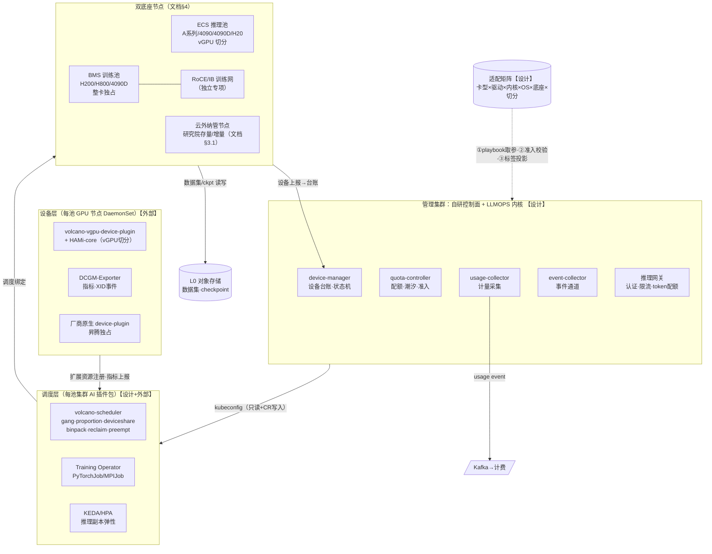

> 图注：①矩阵对管理面的三路输出（playbook 参数 / 准入校验 / 节点池标签投影）是"矩阵为唯一真值源"（正文§5.6）的具体形态；②BMS 训练网为独立专项（正文§7），本图只画接口。

### A2 · 部署拓扑与双底座

**文档§4/§3.1 +【设计】** 管理集群统一纳管池集群；ECS 推理池与 BMS 训练池同为 MCK 集群，云外节点经预检注册入池（过渡态）。

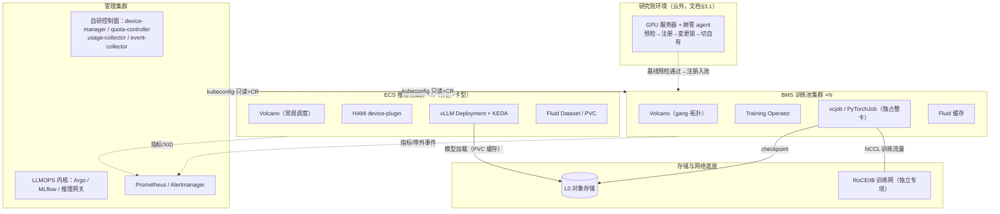

### A3 · 适配矩阵真值源数据流

**【设计】** 正文§5.6"矩阵是调度层与管理层唯一真值源"的数据流视图——验证成果一次登记，四处消费：

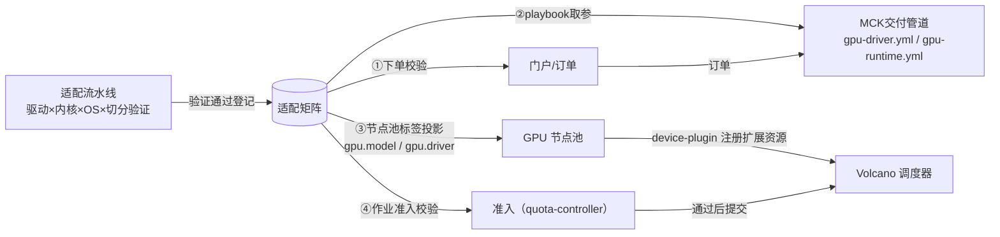

### B1 · 新卡型适配上线（矩阵闭环）

**【设计】，直接对 P3**（原模式：搬迁 1 周 + 开发 2 周 + 测试 2 周，共 1~1.5 个月，文档§2.3）：

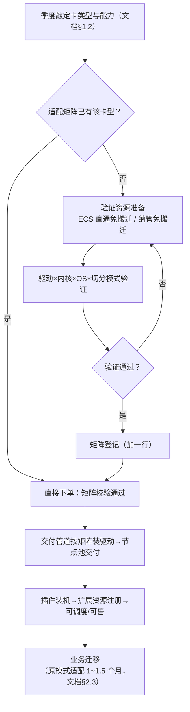

### B2 · 算力供给三通道

**文档§3.1/§1.4 +【设计】** 三条通道殊途同归到"MCK GPU 池"：

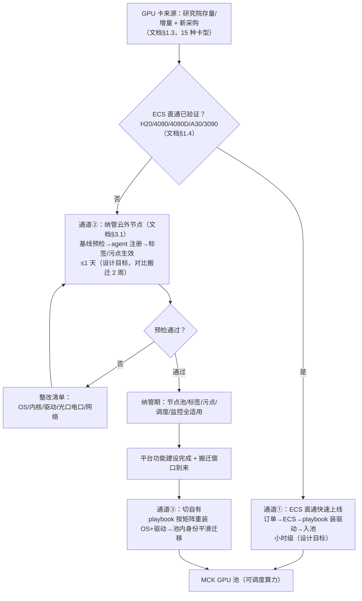

### B3 · 任务生命周期（含挂起/抢占）

**【设计】** 正文§6.3 状态机的流程视图：

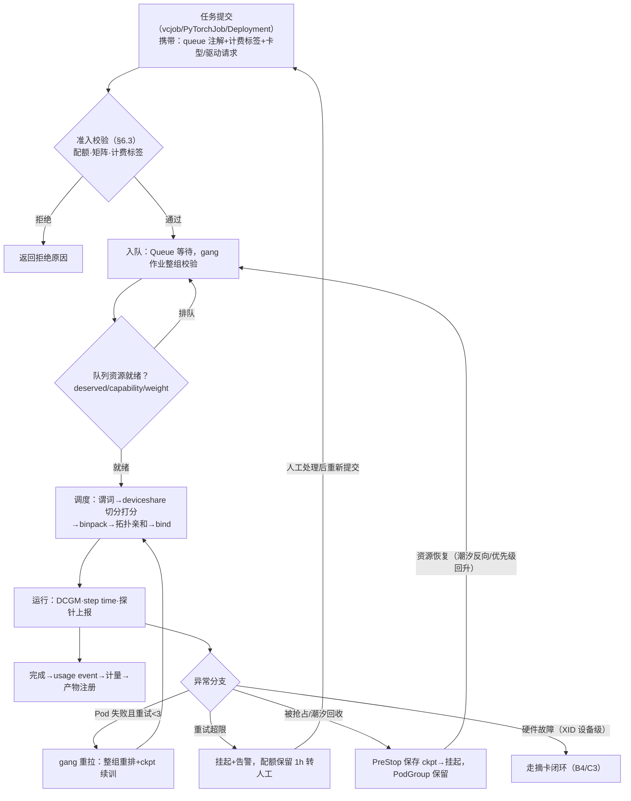

### B4 · 设备故障摘卡闭环

**【设计+外部】** 分级表=算力详设§4.5.1；正文§3.3 的流程视图：

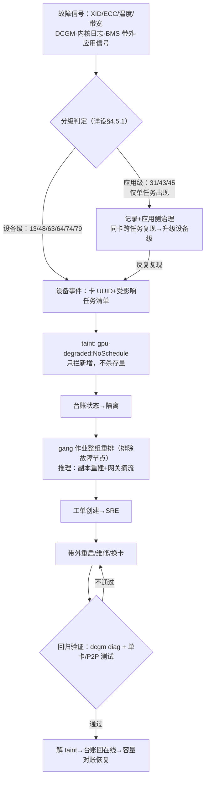

### C1 · 训练任务端到端时序

**【设计+外部】** 正文§5.3/§5.4 + §6.3 的时序视图；故障分支见 C3：

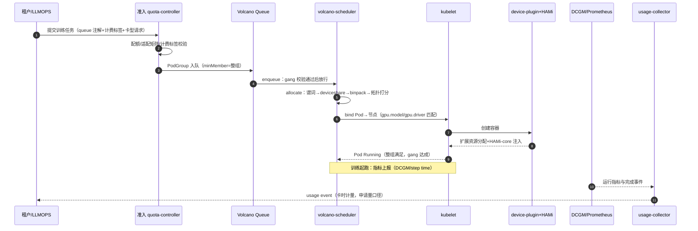

### C2 · 推理请求与弹性伸缩时序

**【设计+外部】** 正文§6.5/§7 推理侧：

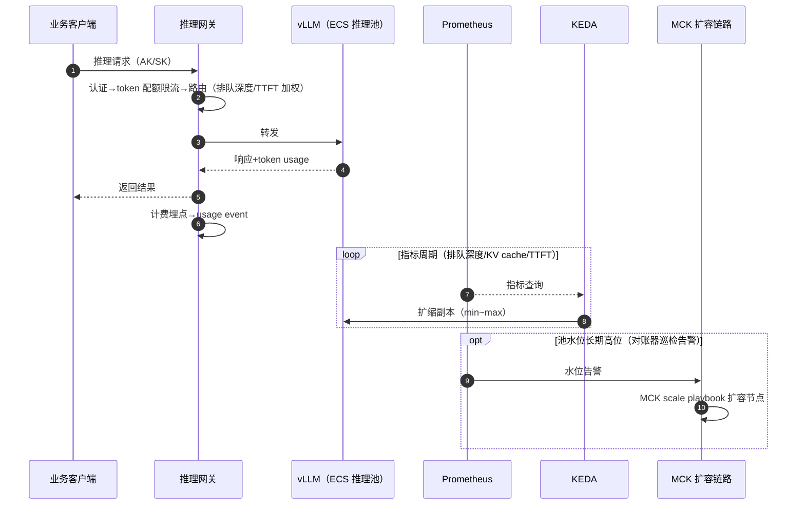

### C3 · XID 故障摘卡闭环时序

**【设计+外部】** 算力详设§4.5.1 摘卡时序的时序图视图：

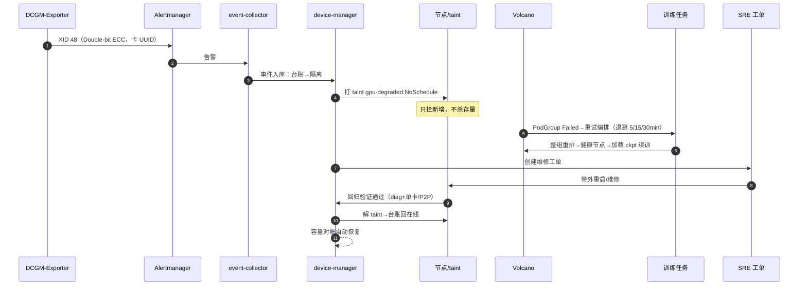

### C4 · 潮汐借还时序

**【设计】** 正文§5.5 潮汐链路（示例时刻为设计示意）：

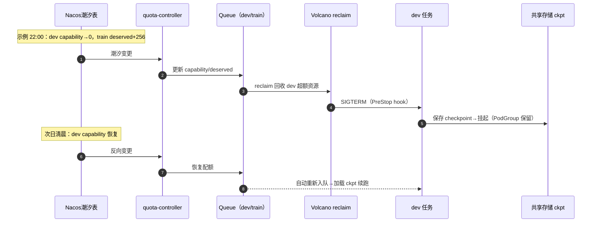

### C5 · 云外节点纳管→切自有时序

**文档§3.1 +【设计】** 正文§3.4 四步法的时序视图：

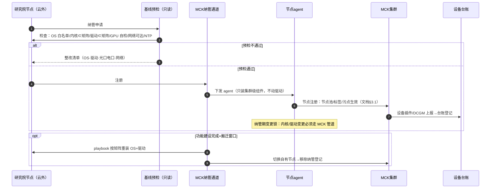
